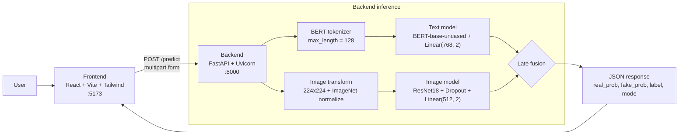
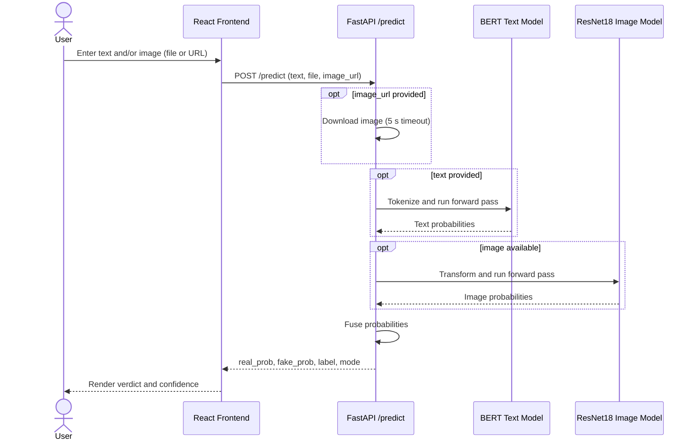
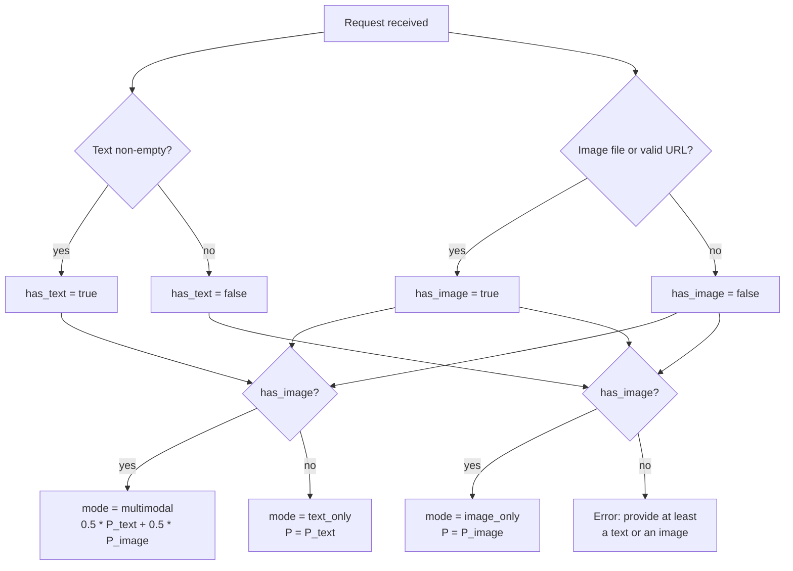

# Fake News Detection


A multimodal fake news detector. Submit a piece of text, an image (file upload or URL), or both, and the system returns the probability that the content is **real** or **fake**.

A BERT text classifier and a ResNet18 image classifier run independently. When both inputs are provided, their probabilities are combined by late fusion.

---

## Table of Contents

1. [Features](#features)
2. [Architecture](#architecture)
3. [Request Flow](#request-flow)
4. [Inference Logic](#inference-logic)
5. [Models](#models)
6. [Project Structure](#project-structure)
7. [Getting Started](#getting-started)
8. [API Reference](#api-reference)
9. [Notes and Configuration](#notes-and-configuration)
10. [Roadmap and Known Limitations](#roadmap-and-known-limitations)
11. [License](#license)

---

## Features

- Text-only, image-only, or multimodal analysis, chosen automatically from the inputs provided.
- Image input by file upload or by public image URL.
- Real / fake confidence scores in percent.
- FastAPI backend with interactive docs at `/docs`.
- React + Vite + Tailwind frontend with image preview.
- GPU acceleration when CUDA is available, CPU fallback otherwise.

---

## Architecture



---

## Request Flow



---

## Inference Logic



In plain text:

```
text + image   -> multimodal  -> P = 0.5 * P_text + 0.5 * P_image
text only      -> text_only   -> P = P_text
image only     -> image_only  -> P = P_image
neither        -> error response

label = 0 (real) if real_prob > fake_prob, otherwise 1 (fake)
```

---

## Models

| Component | Architecture | Input | Weights file |
|-----------|--------------|-------|--------------|
| Text classifier | `bert-base-uncased` + `Linear(768, 2)` (pooler output) | Text, truncated/padded to 128 tokens | `text_only_bert.pt` |
| Image classifier | ResNet18 with `Dropout(0.3)` + `Linear(512, 2)` head | RGB image, resized to 224x224, ImageNet mean/std | `best_image_model.pt` |
| Fusion | Late fusion, equal-weight average of softmax outputs | Both probability vectors | (none) |

Class order in the output: index 0 = real, index 1 = fake.

The text loader falls back to `AutoModelForSequenceClassification` (2 labels) if the checkpoint does not match the custom `TextClassifier` layout.

### Experimental model (not used by the API yet)

`src/models/classifier.py` defines `RobustMultimodalModel`, a joint model that handles missing modalities:

```
text  -> BERT pooler (768) --------------------\
                                                +-> concat (1280) -> Linear(256) -> LayerNorm -> ReLU -> Dropout(0.3) -> Linear(2)
image -> ResNet18 (512) or learned missing-vector /
```

`configs/default.yaml` holds a Kaggle-oriented training configuration (RoBERTa / ViT, batch size 16, lr 2e-5, 4 epochs).

---

## Project Structure

```
FakeNewsDetection/
|-- backend/
|   |-- main.py               FastAPI app: model loading and /predict endpoint
|   |-- requirements.txt      Backend dependencies
|   `-- model/                Place *.pt weights here (gitignored)
|-- frontend/
|   |-- index.html
|   |-- package.json          React 18, Vite 5, Tailwind 3
|   |-- vite.config.js
|   |-- tailwind.config.js
|   |-- postcss.config.js
|   `-- src/
|       |-- main.jsx          React entry point
|       |-- App.jsx           UI and API call
|       `-- index.css         Tailwind styles
|-- src/                      Research / training code
|   |-- models/
|   |   |-- classifier.py     RobustMultimodalModel (experimental)
|   |   `-- encoders.py       (empty, planned)
|   |-- training/train.py     (empty, planned)
|   |-- data/
|   |   |-- prepare.py        (empty, planned)
|   |   `-- emedding_dataset.py (empty, planned)
|   |-- stats/significance.py (empty, planned)
|   `-- explain/shap_analysis.py (empty, planned)
|-- configs/default.yaml      Training configuration
|-- requirements.txt          Root Python dependencies
|-- start.bat                 Windows launcher for backend and frontend
`-- .gitignore                Ignores venvs, node_modules, *.pt, *.pth, *.safetensors, .env
```

---

## Getting Started

### Prerequisites

- Python 3.10 or newer
- Node.js 18 or newer and npm
- Trained weights `text_only_bert.pt` and `best_image_model.pt`
- Internet access on first run (to download `bert-base-uncased` from Hugging Face)

### 1. Add the model weights

Weights are excluded from git (files over 100 MB are rejected by GitHub). Place them manually:

```
backend/model/text_only_bert.pt
backend/model/best_image_model.pt
```

The backend also looks in a top-level `model/` folder if `backend/model/` does not exist. It stops with a `FileNotFoundError` if either file is missing.

### 2. Backend

```bash
cd backend
python -m venv venv
venv\Scripts\activate          # Windows
# source venv/bin/activate     # macOS / Linux
pip install -r requirements.txt
python -m uvicorn main:app --reload --port 8000
```

API docs: http://localhost:8000/docs

### 3. Frontend

```bash
cd frontend
npm install
npm run dev
```

App: http://localhost:5173

### One-click start (Windows)

After the first-time setup above, `start.bat` opens two terminals: the backend (venv activated, port 8000) and the frontend dev server.

```bash
start.bat
```

---

## API Reference

### `GET /`

Health check.

```json
{ "status": "ok", "message": "Fake News Detection API is running" }
```

### `GET /predict`

Returns an info message. The endpoint itself expects `POST`.

### `POST /predict`

Content type: `multipart/form-data`. At least one of the fields below is required.

| Field | Type | Description |
|-------|------|-------------|
| `text` | string | News text to analyze |
| `file` | file | Image upload |
| `image_url` | string | Public `http://` or `https://` image URL (used only if no file is sent) |

Successful response:

```json
{
  "real_prob": 12.34,
  "fake_prob": 87.66,
  "label": 1,
  "has_text": true,
  "has_image": true,
  "mode": "multimodal"
}
```

| Field | Meaning |
|-------|---------|
| `real_prob`, `fake_prob` | Percentages (0-100), rounded to 2 decimals |
| `label` | `0` = real, `1` = fake |
| `mode` | `text_only`, `image_only` or `multimodal` |

Errors are returned with HTTP 200 as `{ "error": "..." }` (invalid image file, invalid URL, image download failure, or no input given).

Example:

```bash
curl -X POST http://localhost:8000/predict \
  -F "text=Breaking: scientists discover ..." \
  -F "file=@photo.jpg"
```

---

## Notes and Configuration

- **CORS** is open to all origins (`allow_origins=["*"]`). Restrict it before any public deployment.
- **API URL** is hardcoded as `http://localhost:8000/predict` in `frontend/src/App.jsx`.
- **Image URLs** are fetched by the server with a 5 second timeout. Only `http` and `https` are accepted.
- **Device** is selected automatically: CUDA if available, otherwise CPU.
- **Root vs backend requirements**: the root `requirements.txt` additionally lists `numpy`. Both include `timm`, which the current API code does not import.

---

## Roadmap and Known Limitations

Planned:

- Implement the empty modules: data preparation, embedding dataset, training loop, encoders.
- Statistical significance testing (`src/stats/significance.py`) and SHAP-based explanations (`src/explain/shap_analysis.py`).
- Serve the joint `RobustMultimodalModel` instead of two separate models with fixed 50/50 fusion.
- Configurable API URL in the frontend (environment variable).
- Tests, Docker setup and CI.

Known limitations:

- Fusion weights are fixed at 0.5 / 0.5 and are not learned.
- The backend does not validate uploaded image size, and the server fetches user-supplied URLs (SSRF risk if exposed publicly).
- Errors are returned with a 200 status code.
- No training code is included yet, so the provided weights cannot be reproduced from this repository.

---


