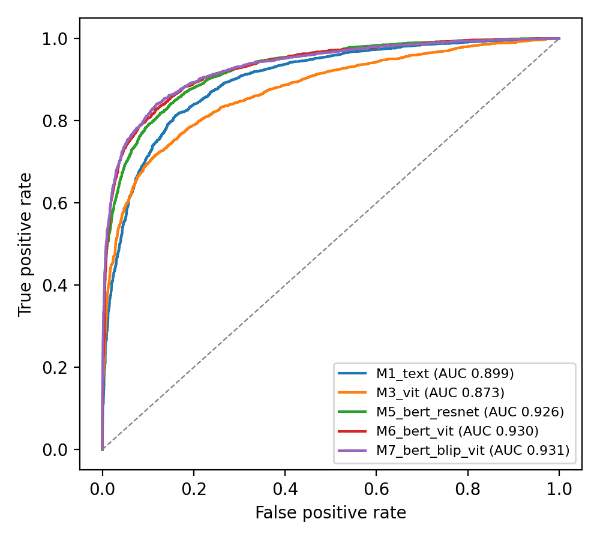
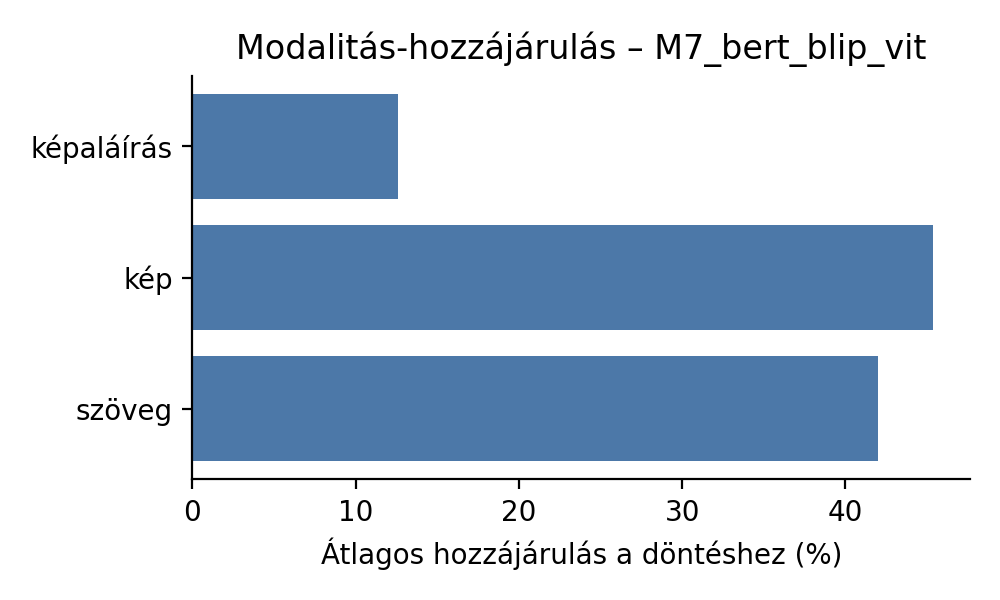
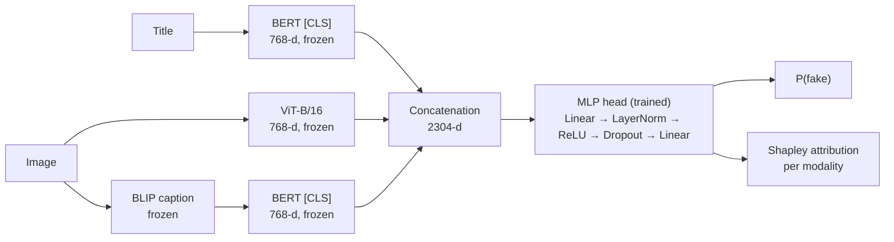
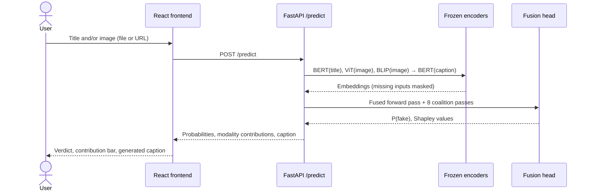

# Fake News Detection


A multimodal fake news detector built as a BSc thesis project. It classifies a news post from its **title**, its **image**, or both, and explains which input drove the decision.

The final model combines three frozen pretrained encoders (BERT for the title, a Vision Transformer for the image, and a BLIP-generated image caption encoded with BERT) through a small trained fusion head. On a 47.5k-post subset of [Fakeddit](https://github.com/entitize/Fakeddit) it reaches **F1 = 0.851 ± 0.002** and **AUC = 0.931** (mean ± std over 10 seeds).

---

## Table of Contents

1. [Results](#results)
2. [Research Questions and Findings](#research-questions-and-findings)
3. [Architecture](#architecture)
4. [Dataset](#dataset)
5. [Project Structure](#project-structure)
6. [Running the App](#running-the-app)
7. [Reproducing the Experiments](#reproducing-the-experiments)
8. [API Reference](#api-reference)
9. [Limitations](#limitations)
10. [References](#references)

---

## Results

All models use the same stratified test split (7,136 posts). Numbers are mean ± standard deviation over 10 training seeds.

| ID | Model | Text | Image | Caption | Fusion | F1 | AUC |
|----|-------|------|-------|---------|--------|----|-----|
| M1 | Text only | BERT | – | – | – | 0.815 ± 0.002 | 0.897 |
| M2 | Image only (CNN) | – | ResNet18 | – | – | 0.733 ± 0.010 | 0.822 |
| M3 | Image only (ViT) | – | ViT-B/16 | – | – | 0.781 ± 0.004 | 0.870 |
| M4 | Late fusion | BERT | ResNet18 | – | 0.5 / 0.5 average | 0.834 ± 0.003 | 0.917 |
| M5 | BERT + ResNet | BERT | ResNet18 | – | concat + MLP | 0.837 ± 0.003 | 0.927 |
| M6 | BERT + ViT | BERT | ViT-B/16 | – | concat + MLP | 0.847 ± 0.003 | 0.930 |
| **M7** | **BERT + BLIP + ViT** | BERT | ViT-B/16 | BLIP | concat + MLP | **0.851 ± 0.002** | **0.931** |
| M8 | M7 + CLIP score | BERT | ViT-B/16 | BLIP | concat + MLP | 0.849 ± 0.003 | 0.932 |

**Ablation** (removing one branch from M7):

| Variant | F1 | Δ vs M7 |
|---------|----|---------|
| M7 (text + image + caption) | 0.851 | – |
| − caption (= M6) | 0.847 | −0.5 |
| − image (A2: text + caption) | 0.827 | −2.4 |
| − text (A1: image + caption) | 0.784 | −6.7 |

**Significance tests** (paired t-test and Wilcoxon over the 10 seed F1 scores; exact McNemar per seed on the test predictions):

| Comparison | ΔF1 | t-test p | Wilcoxon p | McNemar significant |
|------------|-----|----------|------------|---------------------|
| M3 ViT vs M2 ResNet | +0.048 | < 0.001 | 0.002 | 10/10 seeds |
| M6 multimodal vs M1 text | +0.032 | < 0.001 | 0.002 | 10/10 seeds |
| M6 ViT vs M5 ResNet (multimodal) | +0.010 | < 0.001 | 0.002 | 5/10 seeds |
| M5 concat vs M4 late fusion | +0.003 | 0.09 | 0.11 | 7/10 seeds |
| M7 + caption vs M6 | +0.004 | 0.005 | 0.010 | 2/10 seeds |
| M8 + CLIP vs M7 | −0.002 | 0.24 | 0.43 | 0/10 seeds |
| A2 text + caption vs M1 text | +0.012 | < 0.001 | 0.002 | 10/10 seeds |

**Modality attribution** for M7 (exact Shapley values per modality on the test set):

| Modality | Mean share of the decision | Dominant in % of posts |
|----------|----------------------------|------------------------|
| Image | 45% | 54% |
| Text | 42% | 43% |
| Caption | 13% | 3% |

<p>
  
  
</p>

Full tables: [`results/table_main.md`](results/table_main.md), [`results/significance.csv`](results/significance.csv), [`results/stats.csv`](results/stats.csv), [`results/shap/`](results/shap/).

---

## Research Questions and Findings

**RQ1 — Does a Vision Transformer image representation help compared with a CNN?**
Yes. On images alone ViT beats ResNet18 by 4.8 F1 points, significant on every test and every seed. Inside the multimodal model the gain is smaller (+1.0 F1) but consistent across all 10 seeds (Wilcoxon p = 0.002); within a single run it is borderline (McNemar significant on 5 of 10 seeds). Adding the image to the text improves F1 by 3.2 points. Changing the fusion method alone (late fusion → concatenation, M4 → M5) is not significant, so the improvement comes from the better image encoder rather than from the fusion strategy.

**RQ2 — Do BLIP image captions improve detection?**
Slightly. The caption adds +0.45 F1 on top of text and image, consistent across seeds (Wilcoxon p = 0.010) but too small to show within a single run. Without the image the caption adds +1.2 F1 to the text model (significant on every test), which shows it does carry visual information into the text space. A CLIP text–image similarity score adds nothing on top (M8).

**RQ3 — Which modality drives individual decisions?**
The image moves individual predictions the most (45% mean share, dominant in 54% of posts), closely followed by the text (42%); the caption contributes 13%. The ablation ranks the branches differently (removing text costs 6.7 F1, removing the image 2.4), because it measures how much *irreplaceable* information a branch holds, while Shapley values measure how strongly a branch *pushes* each prediction. A gradient-based SHAP explainer gives the same ordering as the Shapley values.

---

## Architecture



Key design decisions:

- **Frozen encoders, cached embeddings.** Embeddings are extracted once and stored as `.npy` files; only the small fusion head is trained. One model trains in minutes, so every configuration can be run with 10 seeds.
- **Learned missing-modality vectors.** Each branch has a learned "absent" vector. During training one modality is randomly dropped per sample (`--modality-dropout 0.15`), so the same model handles text-only, image-only and multimodal inputs in the app.
- **Exact modality-level Shapley values.** With three modalities, all 2³ coalitions are evaluated (absent modality = its learned missing vector). The attributions sum exactly to the predicted probability minus the all-missing baseline.
- **One code path.** The backend imports the same encoder classes (`src/models/encoders.py`) as the training pipeline, so preprocessing cannot drift between training and serving.

### Request flow



---

## Dataset

- **Text and labels:** Fakeddit multimodal samples ([Kaggle mirror](https://www.kaggle.com/datasets/vanshikavmittal/fakeddit-dataset)), binary `2_way_label`.
- **Images:** [Fakeddit-50k](https://www.kaggle.com/datasets/rajatdhanuka/fakeddit-50k), 50,000 pre-downloaded images (the original Fakeddit image URLs are largely dead).

Preprocessing (`src/data/prepare.py`):

1. Join the TSV files with the available images by post ID (50,000 matches).
2. Map labels to the project convention **0 = real, 1 = fake**. The encoding is detected from r/theonion posts (satire = fake): `2_way_label == 0` is fake.
3. Remove duplicate titles (2,340) and titles with conflicting labels (89) to prevent train/test leakage.
4. Stratified 70 / 15 / 15 split with seed 42.

| Split | Real | Fake | Total | Fake ratio |
|-------|------|------|-------|------------|
| Train | 17,428 | 15,871 | 33,299 | 0.477 |
| Val | 3,735 | 3,401 | 7,136 | 0.477 |
| Test | 3,735 | 3,401 | 7,136 | 0.477 |

Titles average 8.1 words. 20 images (0.04%) could not be decoded and are treated as a missing modality.

---

## Project Structure

```
FakeNewsDetection/
|-- backend/
|   |-- main.py                 FastAPI app: fusion pipeline, /predict, /model-info
|   |-- legacy.py               Fallback to the old models if fusion_head.pt is missing
|   |-- requirements.txt
|   `-- model/                  fusion_head.pt goes here (gitignored)
|-- frontend/                   React 18 + Vite + Tailwind UI
|-- src/
|   |-- data/
|   |   |-- prepare.py          Join, label mapping, dedup, stratified split
|   |   `-- extract.py          Embedding extraction (BERT, ViT, ResNet18, BLIP, CLIP)
|   |-- models/
|   |   |-- encoders.py         Frozen encoders shared by training and backend
|   |   `-- classifier.py       FusionHead with learned missing-modality vectors
|   |-- training/train.py       Train one configuration over several seeds
|   |-- eval/
|   |   |-- metrics.py          Accuracy, precision, recall, F1, AUC, confusion matrix
|   |   |-- late_fusion.py      M4 baseline from two models' predictions
|   |   `-- report.py           Result tables, ROC curves, confusion matrices
|   |-- stats/significance.py   McNemar, paired t-test, Wilcoxon
|   `-- explain/shap_analysis.py  Modality-level Shapley values + gradient SHAP
|-- notebooks/
|   |-- kaggle_pipeline.ipynb   Full pipeline on Kaggle (GPU)
|   `-- colab_pipeline.ipynb    Same pipeline on Google Colab
|-- results/                    Tables and figures from the final run
|-- tests/smoke_test.py         End-to-end check on synthetic embeddings
|-- configs/default.yaml        Default hyperparameters
|-- requirements.txt
`-- start.bat                   One-click start on Windows
```

---

## Running the App

### Prerequisites

- Python 3.10 or newer
- Node.js 18 or newer
- The trained head `fusion_head.pt` in `backend/model/` (produced by the training notebook)
- Internet access on first start, to download BERT, ViT and BLIP from Hugging Face (~2 GB, cached afterwards)

### Windows (one click)

```bash
py -m venv venv
venv\Scripts\python -m pip install -r requirements.txt
start.bat
```

`start.bat` installs missing packages and frontend dependencies on first run, then opens the backend (port 8000) and the frontend (port 5173) in two terminals.

### Manual (any OS)

```bash
python -m venv venv
source venv/bin/activate          # Windows: venv\Scripts\activate
pip install -r requirements.txt

cd backend && python -m uvicorn main:app --port 8000      # terminal 1
cd frontend && npm install && npm run dev                 # terminal 2
```

- App: http://localhost:5173
- API docs: http://localhost:8000/docs
- Loaded model: http://localhost:8000/model-info

A prediction takes a few seconds on CPU, mostly for BLIP caption generation. To use a faster model without captions, export `M6_bert_vit` instead of M7 in the last notebook cell, or point the backend to another checkpoint with the `FUSION_CKPT` environment variable.

### Smoke test

Checks the full training and evaluation pipeline on synthetic embeddings (no downloads, no GPU, about 1–2 minutes):

```bash
python -m tests.smoke_test
```

---

## Reproducing the Experiments

Training runs on a free Kaggle GPU (T4) and takes about 2.5 hours end to end.

1. Push this repository to GitHub (public, or add a token as described in the notebook).
2. On Kaggle, create a notebook, **File → Import Notebook** → `notebooks/kaggle_pipeline.ipynb`.
3. Settings: **Accelerator GPU T4 x2**, **Internet On**.
4. **Add Input**: the two datasets listed under [Dataset](#dataset).
5. **Save Version → Save & Run All**.
6. From the Output tab download `fusion_head.pt` → `backend/model/` and `results_export.zip` → unzip into `results/`.

| Phase | What it does | Time (T4) |
|-------|--------------|-----------|
| 0 | Data preparation and split | ~1 min |
| 1 | BERT, ViT and ResNet18 embeddings | 20–40 min |
| 2 | M1–M6, 10 seeds each | 10–20 min |
| 3 | BLIP captions (~65 min), CLIP scores (~9 min), M7, M8, ablations | ~1.5 h |
| 4–5 | Tables, significance, SHAP, export | a few min |

Saving the `emb` output folder as a Kaggle dataset and adding it as an input skips phases 0–1 and the caption extraction on later runs. A Google Colab version (`notebooks/colab_pipeline.ipynb`) stores everything on Google Drive.

Individual steps can also be run directly, for example:

```bash
python -m src.training.train --name M6_bert_vit --features text_bert img_vit \
    --emb-dir emb --splits emb/splits.csv --out results
python -m src.stats.significance --out results --pairs M6_bert_vit:M1_text
python -m src.explain.shap_analysis --ckpt results/models/M7_bert_blip_vit_seed42.pt \
    --emb-dir emb --splits emb/splits.csv --out results
```

---

## API Reference

### `GET /model-info`

Which model is loaded and its test metrics.

```json
{
  "engine": "fusion",
  "model": "M7_bert_blip_vit",
  "features": ["text_bert", "img_vit", "caption_bert"],
  "fusion": "concat + MLP",
  "test_f1": 0.85
}
```

### `POST /predict`

`multipart/form-data`, at least one field required.

| Field | Type | Description |
|-------|------|-------------|
| `text` | string | News title or text |
| `file` | file | Image upload |
| `image_url` | string | Public `http(s)` image URL (used if no file is sent) |

Example response (illustrative values):

```json
{
  "real_prob": 23.41,
  "fake_prob": 76.59,
  "label": 1,
  "has_text": true,
  "has_image": true,
  "mode": "multimodal",
  "engine": "fusion",
  "caption": "a man standing in front of a building",
  "contributions": [
    {"modality": "szöveg", "value": 0.18, "share": 51.2, "direction": "fake"},
    {"modality": "kép", "value": 0.14, "share": 39.8, "direction": "fake"},
    {"modality": "képaláírás", "value": -0.03, "share": 9.0, "direction": "real"}
  ]
}
```

| Field | Meaning |
|-------|---------|
| `real_prob`, `fake_prob` | Percentages (0–100) |
| `label` | `0` = real, `1` = fake |
| `mode` | `text_only`, `image_only` or `multimodal` |
| `caption` | BLIP caption of the image (M7 only) |
| `contributions` | Shapley value per present modality: `value` is the change in P(fake), `share` the percentage of the total absolute attribution, `direction` which class it pushes towards. Modality names are in Hungarian, matching the UI. |

Errors are returned as `{ "error": "..." }`.

```bash
curl -X POST http://localhost:8000/predict \
  -F "text=scientists discover giant stone head shaped rock in field" \
  -F "file=@photo.jpg"
```

---

## Limitations

- **Distant supervision.** Fakeddit labels come from the subreddit a post was published in, not from per-post fact-checking. The `subreddit` field is never used as an input.
- **Subset and frozen encoders.** The models train on 33k posts with frozen encoders, below the scale of full fine-tuning on all ~560k Fakeddit posts reported in the literature.
- **Short English titles only.** The models were trained on Reddit titles (8 words on average) and are not expected to generalise to long articles or other languages.
- **Single dataset.** Cross-dataset generalisation (e.g. FakeNewsNet) is not evaluated.
- **Concatenation fusion.** More expressive fusion (co-attention) and an image-manipulation branch are left for future work.
- **Deployment.** CORS is open to all origins and the server fetches user-supplied image URLs; both must be restricted before any public deployment.

---

## References

- Nakamura, K., Levy, S., Wang, W.Y. (2020). *Fakeddit: A New Multimodal Benchmark Dataset for Fine-grained Fake News Detection.* LREC 2020. [Paper](https://aclanthology.org/2020.lrec-1.755) · [GitHub](https://github.com/entitize/Fakeddit)
- Athira, A.B., Kumar, S.D.M., Chacko, A.M. (2025). *Pretrained transformers for multimodal fake news detection: Explainability using SHAP.* Engineering Applications of Artificial Intelligence, 162, 112590.
- Nasser, M. et al. (2025). *A systematic review of multimodal fake news detection on social media using deep learning models.* Results in Engineering, 26, 104752.
- Wang, J. et al. (2024). *LLM-Enhanced multimodal detection of fake news.* PLOS ONE, 19(10), e0312240.
